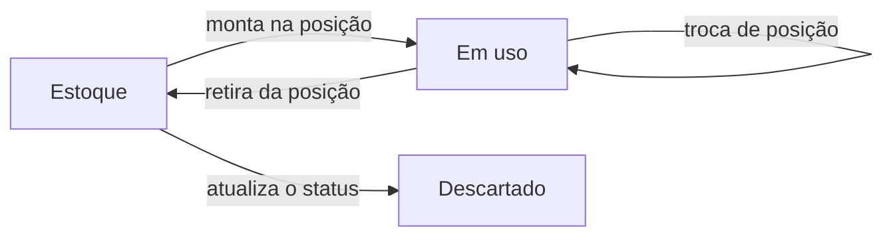

# Rodízio API

Cadastro de pneus e equipamentos de uma oficina, com o lugar de cada pneu: no estoque ou montado numa posição.

A API guarda o pneu, o equipamento e o histórico de cada saída. Montar, tirar e trocar de posição são as três operações que ligam os dois.

Swagger: [http://localhost:8080/swagger-ui.html](http://localhost:8080/swagger-ui.html). A raiz `/` redireciona para lá.

## Para que serve

- Cadastrar pneu e equipamento, com os campos obrigatórios recusados um a um.
- Saber o que está em estoque e o que está em uso.
- Montar um pneu de estoque numa posição livre.
- Devolver esse pneu ao estoque.
- Trocar dois pneus de lugar no mesmo equipamento, ou mover um para uma posição vazia.
- Consultar as movimentações, da mais recente para a mais antiga, e filtrar as listas na própria requisição.

O vínculo não é um campo livre no cadastro do pneu. Ele nasce na montagem.

## A vida de um pneu



| Status | O que significa |
| --- | --- |
| `ESTOQUE` | Disponível para montar. Não está em equipamento. |
| `EM_USO` | Montado numa posição. A API é quem coloca esse status. |
| `DESCARTADO` | Fora de circulação. Não entra em equipamento. |

Um pneu novo pode nascer em estoque ou já descartado. Ele não nasce em uso.

## Regras de negócio

### Código

Código de pneu e de equipamento é único. A API tira o espaço das pontas e grava em maiúsculas, então `apr-a` e `APR-A` são o mesmo código.

### O que é obrigatório

Texto vazio ou só com espaço conta como falta. Se faltar mais de um campo, a resposta lista todos, separados por ponto.

**Pneu:** código, marca, modelo, medida, sulco, quilometragem e status.

**Equipamento:** código, nome, tipo, status e quantidade de posições. A quantidade fica entre 1 e 24.

Placa, observação e data de aquisição podem ir vazios. Aí a API grava `null`. A placa também sobe para maiúsculas.

### Montar

Só entra pneu com status `ESTOQUE` e sem equipamento. A posição precisa existir naquele equipamento e estar livre.

Na hora da montagem o pneu passa para `EM_USO`, ganha a posição e a API registra a saída `estoque → código do equipamento, posição N`.

### Tirar

A posição precisa ter pneu. Ele volta para `ESTOQUE`, perde equipamento e posição, e a saída fica registrada no sentido contrário.

Se o pneu já estiver `DESCARTADO`, o status não muda na retirada.

### Trocar

As duas posições precisam ser válidas para aquele equipamento. A de origem precisa ter pneu. A de destino pode estar vazia: nesse caso o pneu só muda de lugar.

Se as duas estiverem ocupadas, os pneus trocam. Se origem e destino forem a mesma posição, a API não faz nada e responde sucesso.

Cada pneu que muda de lugar gera uma movimentação.

### Atualizar

O corpo vai inteiro de novo, não só o campo alterado.

Enquanto o pneu está montado, o status enviado no corpo é ignorado. Para voltar ao estoque, retire da posição. Para colocar em uso, monte. A API recusa `EM_USO` num pneu que não está em equipamento.

No equipamento, a quantidade de posições não pode ficar menor que uma posição já ocupada. Se a posição 4 tem pneu, a capacidade não desce para 3.

### Excluir

| Quem | Quando a API deixa | Quando ela recusa |
| --- | --- | --- |
| Pneu | Nunca foi montado e não tem movimentação | Está montado, ou já tem histórico |
| Equipamento | Nenhuma posição ocupada | Ainda tem pneu vinculado |

O histórico fica. Por isso um pneu que já rodou não some do cadastro.

## Subindo localmente

Java 21 e PostgreSQL na porta `5432`.

Crie o banco `pneus` e ajuste a URL, o usuário e a senha em `src/main/resources/application.yml`. As tabelas são criadas e atualizadas na subida (`ddl-auto: update`).

```bash
mvn spring-boot:run
```

A API sobe em [http://localhost:8080](http://localhost:8080).

Na primeira subida, se ainda não existir equipamento, entra uma carga de exemplo: caminhão `CAM-042`, empilhadeira `EMP-007`, trator `TRA-015` e os pneus `PN-1001` em diante. Se o banco já tiver equipamento, essa carga não roda de novo.

O CORS libera o front em `http://localhost:5173`.

## Como o erro volta

Quase toda recusa é **400**, sempre com `message`. Vira **404** quando a mensagem diz que algo não foi encontrado ou que não há pneu na posição.

Campo ausente ou vazio entra na lista do que falta. Vários de uma vez, separados por ponto.

```json
{ "message": "Falta o código" }
```

```json
{ "message": "Falta o código. Falta o nome. Falta o tipo" }
```

Valor que não cabe no campo diz qual foi e o que serve no lugar.

```json
{ "message": "Tipo inválido: \"CAMINHA\". Use CAMINHAO, ONIBUS, TRATOR, EMPILHADEIRA, CARREGADEIRA ou OUTRO" }
```

```json
{ "message": "Quantidade de posições inválida: \"seis\". Informe um número" }
```

```json
{ "message": "Status inválido: \"FOO\". Use ESTOQUE, EM_USO ou DESCARTADO" }
```

```json
{ "message": "Data de aquisição inválida: \"13/13/2026\". Use o formato aaaa-mm-dd" }
```

JSON quebrado, ou colado com caractere invisível (slide, Word), também explica o caso em vez do erro genérico do servidor.

```json
{ "message": "O JSON enviado não pôde ser lido. Confira vírgulas, aspas e chaves" }
```

```json
{ "message": "O JSON tem um caractere invisível. Apague o corpo e escreva de novo, sem colar de slide ou documento" }
```

Cadastro e atualização que passam devolvem o recurso. Criar responde **201**. Excluir com sucesso responde **204**, sem corpo.

## Filtros

As listagens filtram na requisição, pela query string. Sem parâmetro, ou com o valor em branco, a lista volta inteira, na mesma ordem de sempre.

Texto é “contém” e ignora maiúscula: `codigo=pn-11` acha `PN-1101`. `%` e `_` entram como texto, não como curinga. Status e tipo são valor exato.

| Lista | Parâmetros |
| --- | --- |
| `GET /api/pneus` | `codigo`, `marca`, `modelo`, `medida`, `status`, `equipamento` |
| `GET /api/pneus/estoque` | `codigo`, `marca`, `modelo`, `medida` |
| `GET /api/equipamentos` | `codigo`, `nome`, `placa`, `tipo`, `status` |
| `GET /api/movimentacoes` | `pneu`, `origem`, `destino` |

`equipamento` e `pneu` comparam o código. O estoque já é só `ESTOQUE` sem equipamento, então essa rota não recebe status nem equipamento.

```
GET /api/pneus?codigo=PN-11&status=ESTOQUE
GET /api/equipamentos?tipo=CAMINHAO
GET /api/movimentacoes?pneu=PN-2001
```

## Endpoints

### Pneus

| Método | Caminho | O que faz |
| --- | --- | --- |
| `GET` | `/api/pneus` | Lista por código. Aceita os filtros da listagem |
| `GET` | `/api/pneus/estoque` | Só os que estão em estoque e sem equipamento. Aceita filtro de texto |
| `GET` | `/api/pneus/{id}` | Busca um |
| `POST` | `/api/pneus` | Cadastra |
| `PUT` | `/api/pneus/{id}` | Atualiza |
| `DELETE` | `/api/pneus/{id}` | Exclui, se nunca teve movimentação |

```json
{
  "codigo": "APR-A",
  "marca": "Pirelli",
  "modelo": "TR01",
  "medida": "295/80R22.5",
  "sulcoMm": 16.0,
  "km": 0,
  "status": "ESTOQUE",
  "dataAquisicao": "2026-11-23",
  "observacao": "Pneu novo"
}
```

Não envie `id`, `equipamento` nem `posicao` no cadastro. A API zera o vínculo.

### Equipamentos

| Método | Caminho | O que faz |
| --- | --- | --- |
| `GET` | `/api/equipamentos` | Lista por código, com os pneus de cada um. Aceita os filtros da listagem |
| `GET` | `/api/equipamentos/{id}` | Busca um, com os pneus montados |
| `POST` | `/api/equipamentos` | Cadastra |
| `PUT` | `/api/equipamentos/{id}` | Atualiza |
| `DELETE` | `/api/equipamentos/{id}` | Exclui, se não houver pneu montado |

```json
{
  "codigo": "APR-EQ",
  "nome": "Volvo FH",
  "tipo": "CAMINHAO",
  "placa": "DEM1A23",
  "quantidadePosicoes": 6,
  "status": "ATIVO",
  "observacao": "Cavalo da linha"
}
```

Tipos: `CAMINHAO`, `ONIBUS`, `TRATOR`, `EMPILHADEIRA`, `CARREGADEIRA`, `OUTRO`.

Status: `ATIVO`, `INATIVO`, `MANUTENCAO`.

### Vínculo

A posição vai na URL. O id do equipamento também.

| Método | Caminho | O que faz |
| --- | --- | --- |
| `POST` | `/api/equipamentos/{id}/posicoes/{posicao}` | Monta um pneu de estoque |
| `DELETE` | `/api/equipamentos/{id}/posicoes/{posicao}` | Tira o pneu e devolve ao estoque |
| `POST` | `/api/equipamentos/{id}/troca` | Troca ou move entre duas posições |

Montar:

```json
{ "pneuId": 1 }
```

Tirar não tem corpo.

Trocar:

```json
{ "posicaoOrigem": 1, "posicaoDestino": 2 }
```

As três operações devolvem o equipamento atualizado, já com os pneus nas posições novas.

### Movimentações

| Método | Caminho | O que faz |
| --- | --- | --- |
| `GET` | `/api/movimentacoes` | Lista as saídas, da mais recente para a mais antiga. Aceita filtro por pneu, origem e destino |

Não existe cadastro manual. Cada montagem, retirada e troca grava sozinha: pneu, origem, destino e data.

Origem e destino saem como `estoque` ou `APR-EQ, posição 1`.

## Campos

### Pneu

| Campo | Obrigatório | Notas |
| --- | --- | --- |
| `codigo` | sim | Único, até 40 caracteres, gravado em maiúsculas |
| `marca` | sim | Até 80 |
| `modelo` | sim | Até 80 |
| `medida` | sim | Até 40 |
| `sulcoMm` | sim | Decimal, uma casa. Ex.: `14.5` |
| `km` | sim | Inteiro |
| `status` | sim | `ESTOQUE`, `EM_USO` ou `DESCARTADO` |
| `dataAquisicao` | não | `aaaa-mm-dd` |
| `observacao` | não | Até 500 |
| `posicao` | — | Preenchida só pela montagem |
| `equipamento` | — | Preenchido só pela montagem |

### Equipamento

| Campo | Obrigatório | Notas |
| --- | --- | --- |
| `codigo` | sim | Único, até 40 caracteres, gravado em maiúsculas |
| `nome` | sim | Até 120 |
| `tipo` | sim | Um dos tipos da lista acima |
| `status` | sim | `ATIVO`, `INATIVO` ou `MANUTENCAO` |
| `quantidadePosicoes` | sim | De 1 a 24 |
| `placa` | não | Até 15, gravada em maiúsculas |
| `observacao` | não | Até 500 |
| `pneus` | — | Lista dos pneus montados, na leitura |

Duas posições do mesmo equipamento não dividem o mesmo número. A restrição fica no banco (`uk_pneu_posicao`).
